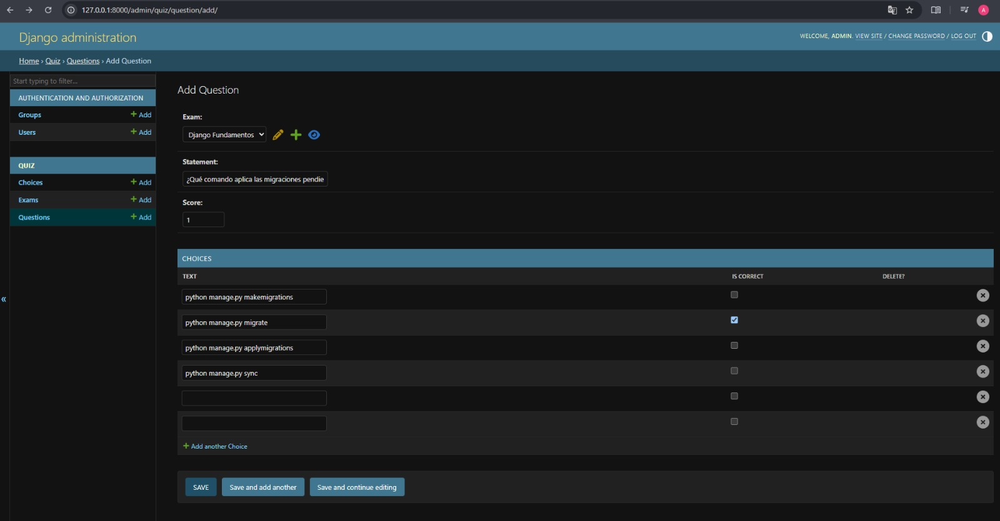
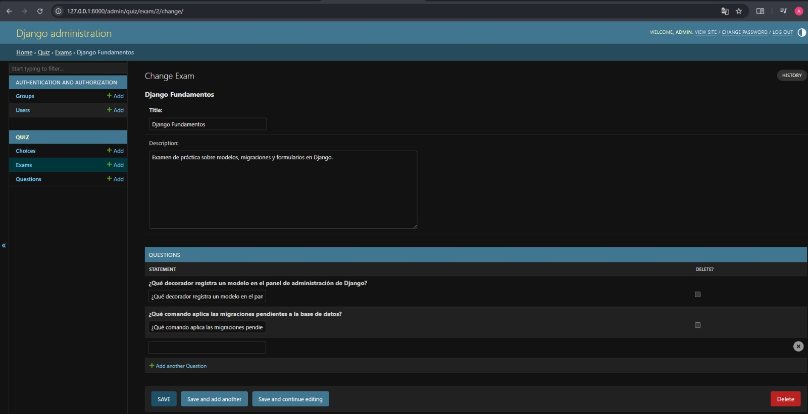
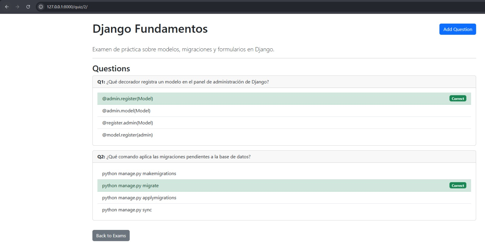
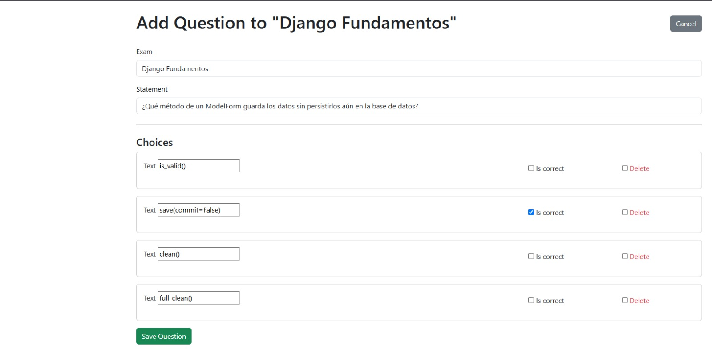
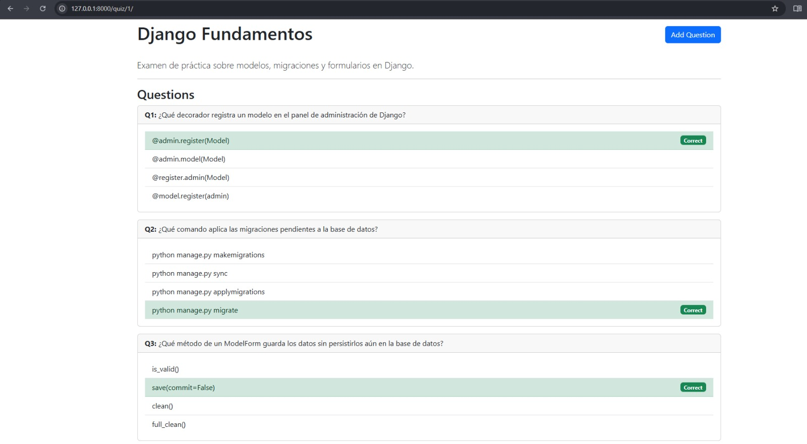
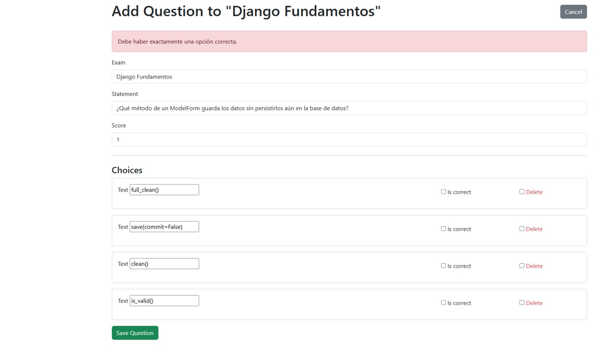
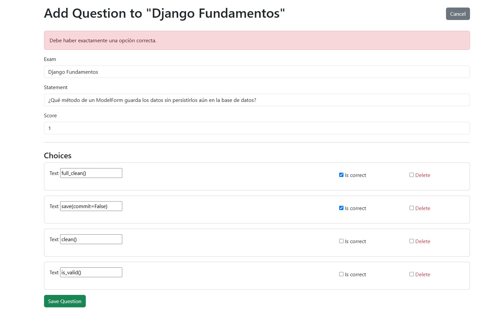

# Quiz App — Django

Proyecto del laboratorio de Semana 3 (Desarrollo de Aplicaciones Empresariales):
creación de modelos, migraciones, formularios con formset y administración para un
sistema de gestión de exámenes tipo quiz.

**Autor:** Alexander Faustino

## ¿Qué hace este proyecto?

Permite **crear y gestionar** exámenes compuestos por preguntas de opción múltiple:

- Un **Exam** (examen) tiene un título, una descripción y varias preguntas.
- Cada **Question** (pregunta) pertenece a un examen, tiene un enunciado y un puntaje
  (`score`), y tiene varias opciones de respuesta.
- Cada **Choice** (opción) tiene un texto y un indicador de si es la respuesta
  correcta (`is_correct`).

Este proyecto **no** incluye la experiencia de "rendir" el examen (elegir una
respuesta sin saber cuál es la correcta y obtener un puntaje al final) — eso queda
fuera del alcance de este laboratorio, que se enfoca en la parte de modelado y
administración.

## Funcionalidad implementada

| Función | Dónde |
|---|---|
| Listado de exámenes | `http://127.0.0.1:8000/quiz/` |
| Detalle de un examen (preguntas + opciones, correcta resaltada) | `http://127.0.0.1:8000/quiz/<id>/` |
| Alta de pregunta con sus opciones (formset) | `http://127.0.0.1:8000/quiz/question/new/?exam=<id>` |
| Administración de exámenes, preguntas y opciones | `http://127.0.0.1:8000/admin/` |


## Estructura del proyecto

```
Lab03-DAE/
├── .opencode/
│   └── agent/              # agentes de OpenCode usados para construir el proyecto
├── venv/                   # entorno virtual 
├── config/                 # carpeta de la estructura del curso
├── src/
│   ├── manage.py            # en la raíz de src/ 
│   ├── config/               # proyecto Django (settings, urls raíz, wsgi, asgi)
│   │   └── config/
│   │       ├── settings.py   # SECRET_KEY, DEBUG, ALLOWED_HOSTS desde .env
│   │       └── urls.py
│   └── quiz/                # app principal
│       ├── models.py         # Exam, Question, Choice
│       ├── forms.py          # ExamForm, QuestionForm, ChoiceFormSet
│       ├── views.py          # exam_list, exam_detail, question_create
│       ├── urls.py           # rutas con app_name = 'quiz'
│       ├── admin.py          # registro de modelos con inlines
│       ├── migrations/       # 0001_initial, 0002_question_score
│       └── templates/quiz/   # base.html, exam_list.html, exam_detail.html,
│                              # question_form.html
├── .env / .env.example
├── requirements.txt
└── .gitignore
```

## Cómo correrlo

```powershell
cd Lab03-DAE
venv\Scripts\activate
cd src
python manage.py runserver
```

Abrir `http://127.0.0.1:8000/quiz/` en el navegador. Para entrar al admin, usar el
superusuario creado con `python manage.py createsuperuser`.

Si es la primera vez que se clona el repositorio, copiar `.env.example` a `.env` y
completar `SECRET_KEY` con cualquier valor antes de correr el servidor.

## Los 3 modelos y justificación de tipos de campo

### Exam
| Campo | Tipo | Por qué |
|---|---|---|
| `title` | `CharField(max_length=150)` | Texto corto con longitud controlada; permite validación a nivel de base de datos y formularios, ideal para títulos. |
| `description` | `TextField(blank=True)` | Texto largo sin límite fijo; `blank=True` lo hace opcional en formularios y admin. |
| `created_at` | `DateTimeField(auto_now_add=True)` | Registra automáticamente la fecha/hora de creación (inmutable), garantizando auditoría sin intervención del usuario. |

### Question
| Campo | Tipo | Por qué |
|---|---|---|
| `exam` | `ForeignKey(Exam, on_delete=CASCADE, related_name='questions')` | Relación obligatoria padre-hijo; `CASCADE` evita preguntas huérfanas al borrar el examen. |
| `statement` | `CharField(max_length=255)` | Enunciado breve con longitud acotada; validación nativa en base de datos y formularios. |
| `score` | `PositiveIntegerField(default=1)` | Entero ≥ 0 para la puntuación; `default=1` simplifica la creación y evita valores nulos. |

### Choice
| Campo | Tipo | Por qué |
|---|---|---|
| `question` | `ForeignKey(Question, on_delete=CASCADE, related_name='choices')` | Vincula cada opción a su pregunta; `CASCADE` mantiene la integridad referencial. |
| `text` | `CharField(max_length=200)` | Texto de la opción con límite razonable; validación automática. |
| `is_correct` | `BooleanField(default=False)` | Decisión binaria (correcta/incorrecta) nativa en base de datos; `default=False` obliga a marcar explícitamente la correcta. |

## Migraciones

- `0001_initial.py`: crea las tablas `quiz_exam`, `quiz_question` y `quiz_choice` con
  todos sus campos y relaciones.
- `0002_question_score.py`: agrega el campo `score` (`PositiveIntegerField`,
  `default=1`) a `Question` mediante `migrations.AddField`. En SQL equivale a
  `ALTER TABLE quiz_question ADD COLUMN score integer NOT NULL DEFAULT 1`, dejando
  el valor 1 en las preguntas ya existentes.

## Casos de prueba — validación del formset

Probados manualmente en `http://127.0.0.1:8000/quiz/question/new/?exam=1`:

| Caso | Acción | Resultado esperado | Resultado obtenido |
|---|---|---|---|
| Exactamente 1 correcta | Marcar una sola opción como `is_correct` | Guarda la pregunta y redirige al detalle del examen |  Correcto |
| 0 correctas | No marcar ninguna opción | No guarda nada, muestra "Debe haber exactamente una opción correcta.", conserva los datos escritos |  Correcto |
| 2 o más correctas | Marcar dos o más opciones | Mismo comportamiento que el caso anterior |  Correcto |

## Capturas













